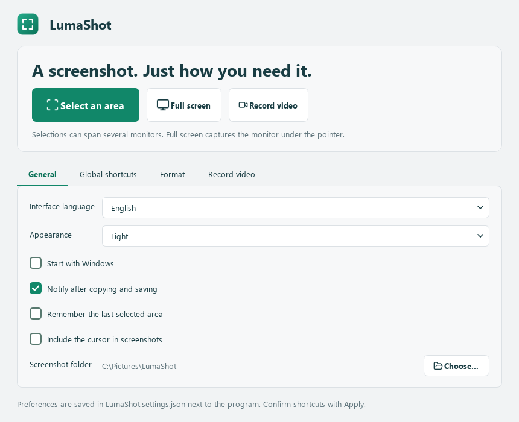
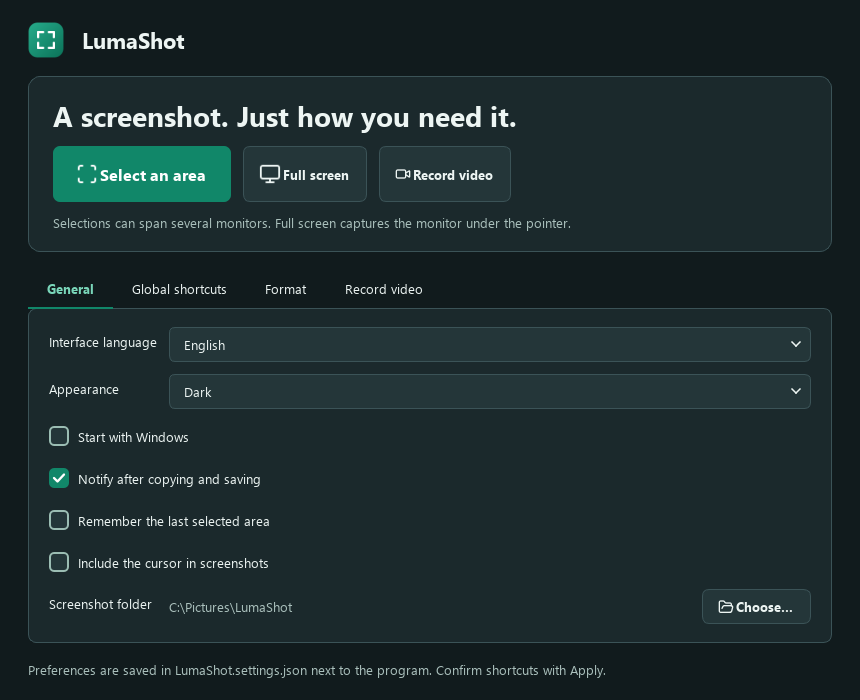
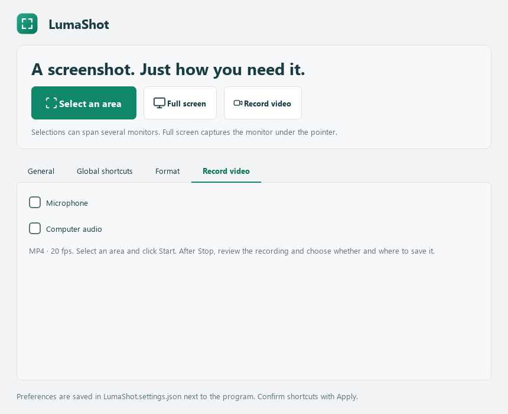
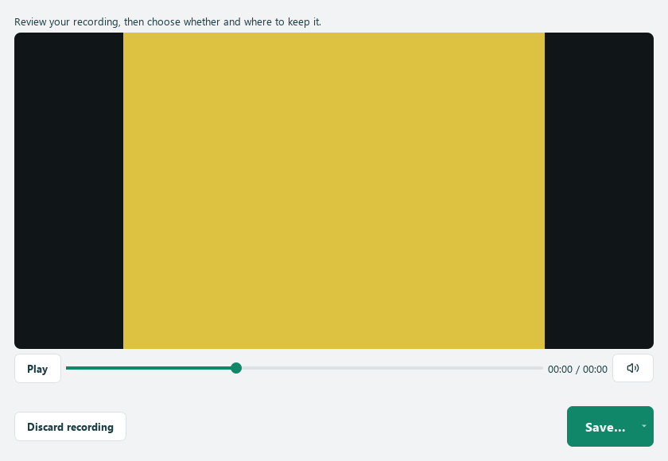
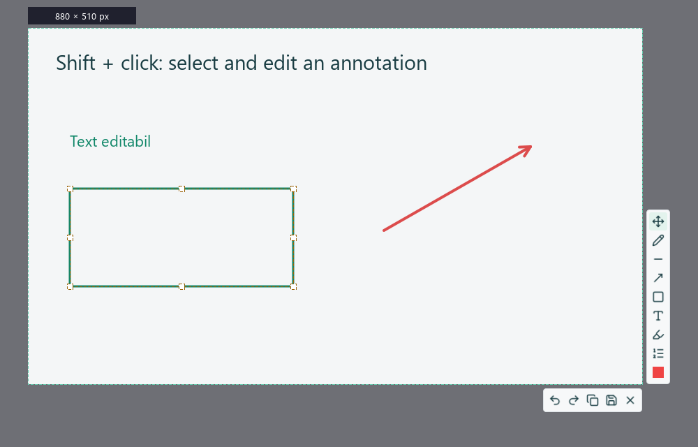

<p align="center">
  
</p>
<h1 align="center">LumaShot</h1>
<p align="center"><strong>A screenshot. Just how you need it.</strong></p>
<p align="center">A compact Windows screenshot tool built with Python and PySide6.<br>Capture across monitors, annotate images, or record an area with optional microphone and computer audio.</p>
<p align="center">
  
  <a href="LICENSE"></a>
  
  
  
</p>
<p align="center">
  <a href="docs/README.ro.md">Română</a> ·
  <a href="docs/README.ru.md">Русский</a> · <strong>English</strong>
</p>
<p align="center">
  <a href="https://github.com/TOKKAB1/LumaShot/raw/refs/heads/main/LumaShot.py">Download Python file</a> ·
  <a href="https://github.com/TOKKAB1/LumaShot/raw/refs/heads/main/LumaShot.ico">Download Windows icon</a> ·
  <a href="https://github.com/TOKKAB1/LumaShot/issues">Report a problem</a>
</p>



## Made for quick explanations

LumaShot takes inspiration from Lightshot's direct selection workflow and useful annotation tools found in Greenshot. It is an independent personal project, with its own interface and icon.

| Capture | Annotate | Keep |
|---|---|---|
| Select a region across monitors | Pen, line, arrow and rectangle | Copy the finished image |
| Print Screen or Ctrl+Shift+F9 | Text, translucent highlight and numbered steps | Save as PNG or JPEG |
| Move or resize the selection | Undo and redo | Choose your screenshot folder |

**Romanian, Russian and English** are built in. Choose your language and a light or dark appearance in **General**; both choices are remembered.

The toolbar uses [Lucide](https://lucide.dev/) icons. The 28 SVGs are embedded in the Python file, rendered at several sizes and cached for reuse. No icon download or extra icon package is needed at runtime.

## Get started

Download the full source from **Code → Download ZIP**, or use the single-file download below. Anyone may use, modify and redistribute the original LumaShot code under the [MIT license](LICENSE), including commercially, provided the license and copyright notice are retained.

Requires **Windows 10 (2004+) or Windows 11**, **Python 3.10+**, **PySide6** and **SoundCard** (which installs NumPy and CFFI). Development and local tests were run on Windows with Python 3.14 and PySide6 6.12.0.

Download [`LumaShot.py`](LumaShot.py), open a terminal in its folder, then run:

```powershell
python -m pip install PySide6==6.12.0 SoundCard==0.4.6
python LumaShot.py
```

The source application lives in **one Python file**. For Windows without Python, use the supplied portable Windows ZIP, extract the entire folder and run **LumaShot.exe**. Keep the `_internal` folder beside it. To build it yourself, double-click [build_exe.bat](build_exe.bat); see the [build guide](docs/BUILD.md). The `.ico` file is optional: the app draws its own icon even when you only download the script.

<details>
<summary>Prefer a separate Python environment?</summary>

```powershell
git clone https://github.com/TOKKAB1/LumaShot.git
cd LumaShot
python -m venv .venv
.\.venv\Scripts\python.exe -m pip install -r requirements.txt
.\.venv\Scripts\python.exe LumaShot.py
```

</details>

## Capture and annotate

Click **Select an area**, left-click the tray icon, or use an available global shortcut. Drag to select an area, then choose a tool from the floating toolbar. Copy with **Ctrl+C** or save with **Ctrl+S**.

The compact editor starts with **Move / resize** selected. It has a vertical tool strip beside the selection and a small action strip below it. Click the current color to open a palette of **24 preset colors** and the stroke-width control; choosing a color closes it again. There is no separate custom-color dialog. Ellipse and redaction are not offered in the toolbar or its shortcuts.

**Enter does not copy or close a capture.** It only confirms text while editing a text annotation. To copy the screenshot, use **Ctrl+C** or the Copy button.

### Set your own shortcut

In **Global shortcuts → Area capture**, click the shortcut field, press your desired combination and click **Apply**. The choice replaces the default shortcuts and is remembered after restarting. If the combination is occupied or reserved by Windows, an error appears and the previous shortcut stays active. If a saved shortcut is unavailable at startup, use the capture button and choose another combination.

Enable or disable each shortcut with its checkbox and confirm with **Apply**. The full-screen shortcut is optional and starts disabled; its suggested combination is `Ctrl+Shift+F10`. Disabling a shortcut keeps the corresponding capture button available.

Use a combination such as `Ctrl+Alt+K`, an F key, or `Print Screen`. Sequences of multiple combinations and plain letter shortcuts are not accepted.


*The screenshots show the current Qt interface. The editor example uses synthetic content, not a user's desktop.*

| Key | Action |
|---|---|
| `Print Screen` / `Ctrl+Shift+F9` | Start a capture, when available |
| `V` | Move the selection or resize it using the four corners or four edge midpoints |
| `P` / `L` / `A` | Pen / line / arrow |
| `R` | Rectangle |
| `T` | Add text; Enter confirms it |
| `H` / `N` | Highlight / numbered step |
| `Ctrl+Z` / `Ctrl+Y` | Undo / redo an annotation |
| `Ctrl+C` | Copy the image |
| `Ctrl+S` | Save the image |
| `Esc` / right-click | Cancel the capture |

When a text field is open, **Esc** discards that text first. Moving the selection changes the crop; annotations remain anchored to their original screen positions.

Left-click the tray icon to select an area. Right-click it for **Select an area**, **Full screen**, **Record video**, **Open LumaShot**, and **Quit**. During recording, the video entry becomes **Stop and review**, and screenshot entries are disabled.

Closing the main window keeps LumaShot in the system tray when it is available. Right-click its petrol-green icon and choose **Quit** to exit completely. A second launch reopens the running app.

## Preferences

| Tab | Settings |
|---|---|
| General | Language, light/dark theme, copy/save notifications, remembered selection, cursor capture, destination folder |
| Global shortcuts | Enable, disable and customize area, full-screen and video shortcuts independently |
| Format | Default PNG/JPEG format, JPEG quality (1–100), full-screen action |
| Record video | Independent microphone and computer-audio preferences |

**Full screen** captures the monitor under the cursor at capture time, at its native pixel resolution. By default it opens the editor with the whole monitor selected. In **Format → When capturing the full screen**, choose **Save immediately to folder** to skip the editor and save directly using the chosen format and quality. This behavior applies to the full-screen button and shortcut. It never uploads an image.

Preferences are written atomically to **LumaShot.settings.json** next to the Python file; keep the program in a writable folder. Existing Windows settings are migrated on the first launch without a JSON file. A damaged JSON file is preserved with a `.damaged-…` suffix and reported. Do not upload your personal JSON to GitHub. General and format preferences save automatically; shortcut changes require **Apply**. Remembered areas are restored after a successful copy or save on the same monitor or desktop layout. Changing the monitor layout resets a remembered cross-monitor selection. Full-screen captures do not replace the remembered area. Cursor capture includes the Windows cursor on its monitor; the editor controls are excluded from exported images.



## Record a selected area



1. Set **Microphone** and **Computer audio** in the **Record video** tab. Both start off and are remembered independently.
2. Click **Record video** or press **Ctrl+Shift+F11**, then drag a region across one or more monitors. The compact control bar appears above the selection; adjust the selection if needed.
3. Click **Start** in the bar. The same bar stays in place with **Stop**, elapsed time, microphone and computer-audio buttons, and **×**. Audio icons show their current on/off state and have translated tooltips.
4. Click **Stop** to open the video preview. **×** cancels before recording starts; during recording it stops and opens the same preview. Choose **Save… → Default folder** or **Choose location…**, or discard the recording. Quit also waits for your decision before exiting.

Video uses H.264/AAC in MP4, targeting 20 fps at the selected area's native resolution. Odd dimensions are padded by one black pixel for the encoder. No external FFmpeg executable is needed. The microphone and playback device are the Windows defaults at the time each source is enabled. Change the default in Windows, then toggle that source off and on to switch devices. Audio input is released when switched off. Disabled sources contribute silence, so they can be enabled later in the same file. Protected audio/video may not be capturable.

The bar stays above the selected area. At a screen edge it moves inside the region and stays usable with the mouse. Windows capture exclusion omits both the bar and its tooltips from the video. If exclusion is unavailable and the bar would overlap the video, Start is blocked with an explanation; selecting an area with room above it is still supported. Very large regions depend on the available encoder and computer performance. Encoder failures are reported; a partially written MP4 is not presented as a successful recording. Recording controls and tooltips are translated into all three languages.

The video shortcut is editable in **Global shortcuts → Select / Start / Stop video**. Its default is **Ctrl+Shift+F11**: select an area, press it again to start, and press it during recording to stop and review. It can be disabled independently; conflicts preserve the previous working shortcut. Shortcut entry fields never trigger recording while being edited.

The magnifier/zoom feature is deferred and is not included in this version.

Tests encode and decode synthetic video and tones, checking both audio toggles independently. Real microphone permissions, playback devices and mixed-DPI monitor combinations still need testing on the target PC.

Recording controls, shown with a simulated timer:


## Messages in the terminal

Qt/FFmpeg may print codec discovery messages, including an unavailable AV1 encoder, while LumaShot records with H.264. The backend can also print `track 0: codec frame size is not set`; the synthetic encode/decode tests verify video and audio in the finalized MP4 despite this diagnostic. These lines alone do not confirm a failed recording. Actual recording errors are still reported in the application and are not suppressed.

The deprecated `QVideoFrameFormat.setFrameRate()` call has been replaced with `setStreamFrameRate()`, as documented by [Qt for Python](https://doc.qt.io/qtforpython-6/PySide6/QtMultimedia/QVideoFrameFormat.html). General backend logging is documented in [Advanced FFmpeg configuration](https://doc.qt.io/qt-6/advanced-ffmpeg-configuration.html).

## Local by design

- No account, cloud upload or telemetry in the application.
- Captures are saved when you choose Save or explicitly enable immediate saving for full-screen captures. Copy places the image on the Windows clipboard.
- Exports contain the selected pixels with annotations applied. They do not embed the original image or editing history.
- Windows clipboard history or cloud sync, if enabled by you, is managed by Windows.

## Windows icon

[`LumaShot.ico`](LumaShot.ico) contains **16, 24, 32, 48, 64, 128 and 256 px** versions with a transparent background.

Use it for a Windows shortcut through **Properties → Change Icon**. A `.py` file itself usually keeps the icon of its associated Python application in File Explorer.

## Current limits

This is **version 0.1**, a first usable version.

- Cross-monitor selections use native desktop pixels. Gaps between displays remain part of the rectangular image; mixed-DPI layouts need further hardware testing.
- Scrolling capture, OCR and automatic window selection are not included.
- Global shortcuts can be occupied by Windows or another screenshot app. The dashboard lists successfully registered shortcuts; the capture button remains available.
- HDR displays and protected video content have not been validated.
- The application does not add itself to Windows startup.

## Development

```powershell
python -m pip install -r requirements.txt
python -m unittest discover -s tests -v
```

The 65 local tests cover themes, optional independent shortcuts, tray clicks, cursor routing, remembered areas, full-screen editing and instant saving, notifications, crop resolution, rendering, undo/redo, PNG/JPEG export, copy, cancelled saves, language switching, toolbar placement, the collapsed palette, shortcut persistence, conflict handling and tooltip content, sizing and dismissal. Additional checks cover JSON migration/recovery, cross-monitor coordinates, persistent recording-bar transitions, video hotkey conflicts and an MP4 encode/decode round trip with independent synthetic audio toggles. They use Qt's offscreen backend; they do not replace testing real multi-monitor or global-hotkey behavior.

| File | Purpose |
|---|---|
| [`LumaShot.py`](LumaShot.py) | Complete application |
| [`LumaShot.ico`](LumaShot.ico) | Windows icon |
| [`requirements.txt`](requirements.txt) | Python dependency |
| [`THIRD_PARTY_NOTICES.md`](THIRD_PARTY_NOTICES.md) | Lucide and Qt notices |
| [`tests/test_capture.py`](tests/test_capture.py) | Screenshot and UI checks |
| [`tests/test_recording.py`](tests/test_recording.py) | JSON, multi-monitor and synthetic video/audio checks |
| [`docs/`](docs/) | Romanian and Russian guides |
| [`assets/`](assets/) | Icon and interface images |

For bug reports, include your Windows version, Python version, display scaling, and steps to reproduce. Use sample screenshots without personal information.

Built with [Qt for Python / PySide6](https://doc.qt.io/qtforpython-6/) and [Lucide icons](https://lucide.dev/). Third-party licenses are retained in [THIRD_PARTY_NOTICES.md](THIRD_PARTY_NOTICES.md); the Lucide notices are also embedded in the standalone script. LumaShot is not affiliated with Lightshot or Greenshot.

## License and contributions

The original LumaShot application code, documentation and petrol-green app icon are offered under the [MIT license](LICENSE), with notice `Copyright (c) 2026 TOKKAB1`. The license is also embedded in the script so it travels with single-file downloads.

Bundled Lucide SVGs retain their ISC/MIT terms and notices. PySide6 and Qt are installed separately and retain their own licenses; the MIT license for LumaShot does not replace those licenses. See [THIRD_PARTY_NOTICES.md](THIRD_PARTY_NOTICES.md) for sources and notices.

This repository distributes Python source and original project assets, not Lightshot or Greenshot code, logos or binaries. The project is independent of those products.

Improvements and translations are welcome. See [CONTRIBUTING.md](CONTRIBUTING.md) before opening a pull request.


## Recording improvements in 0.3.0

The recording bar includes **Pause / Resume**. Pause freezes the timer, releases
the audio inputs and excludes the paused time from the saved file. Resume continues
the same MP4. You can also stop while paused, then review the recording and choose whether to save.

A thin red outline identifies the recorded area; it becomes amber while paused.
It does not intercept mouse clicks. Windows excludes the outline from capture;
if exclusion is unavailable, the lines are positioned outside the selected pixels.
At a display edge this fallback can be partially or completely off-screen.

Audio uses 48 kHz stereo AAC with an explicit 256 kb/s target. WASAPI captures
stereo with a larger input buffer, and a 150 ms submission buffer absorbs scheduling
jitter without shifting the audio timestamps. The old default quality mode could
produce very low AAC bitrates. Stereo separation and 12 kHz content are checked in
an encoded/decoded test, including bursty input delivery. Physical audio devices
and unusual driver configurations still need testing on the user's computer.

Qt may print codec probing messages (including unavailable AV1 encoders) and the
MP4 frame-size warning; LumaShot uses H.264 and checks final output in tests.
Console Ctrl+C behavior is unchanged. The EXE opens without a console.


## Startup, video review and annotation editing

**General → Start with Windows** controls per-user startup. It is off by default.
When enabled, LumaShot starts in the tray at Windows sign-in; turn the checkbox off
to remove its startup entry. Python launches use the current Python environment,
so keep that environment and the script in place. After moving the application,
toggle startup off and on to update its path.

Recordings are temporary until you decide to keep them. After Stop, the preview
offers playback, pause, seeking and preview mute. **Save…** opens two choices:
the default capture folder, or a location selected in a save dialog. Canceling that
dialog keeps the preview open. Save copies the original MP4 without re-encoding;
a failed save keeps the original draft available for retry. **Discard recording**
removes the unsaved draft. Closing the preview asks what to do; quitting during
recording also waits for this choice. A custom save location does not change your
default capture folder.



In **Move / resize (V)**, hold **Shift** and click an annotation to select it.
Shift-drag the annotation to move it, or drag its handles while holding Shift to
resize it. Lines and arrows have editable endpoints; rectangles, highlights,
freehand strokes and text have bounding handles. **Shift + double-click** on text
opens its text editor; Enter confirms and Esc cancels the text change. The palette
and thickness control apply to the selected object. **Shift+Delete** removes it.
**Ctrl+Z / Ctrl+Y** undo and redo both drawing and editing. A normal click returns
to adjusting the capture region. Editing handles are not exported in screenshots.


