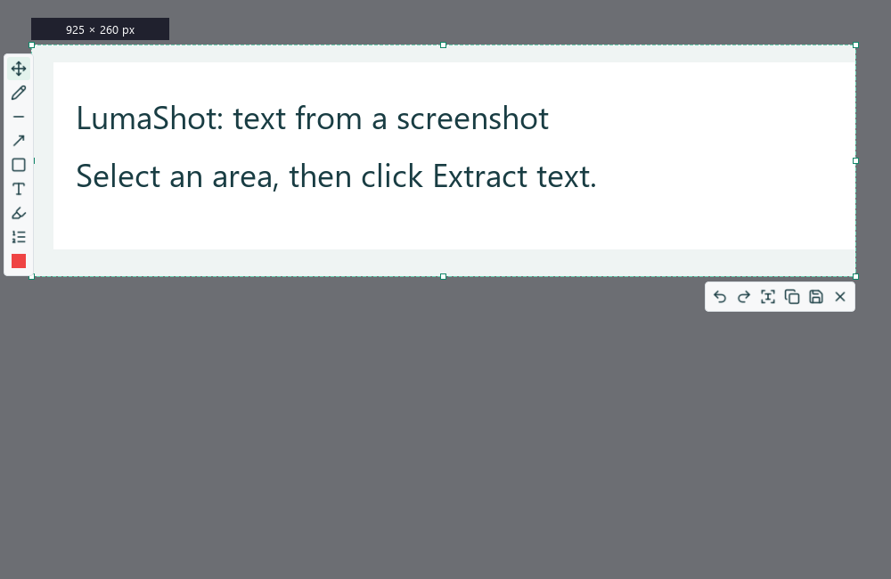
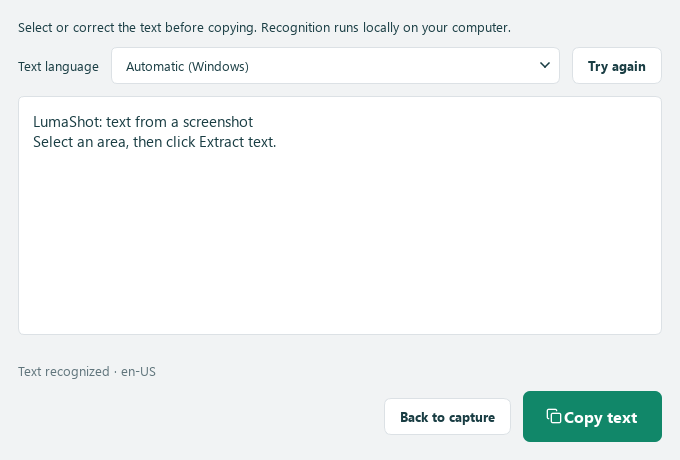
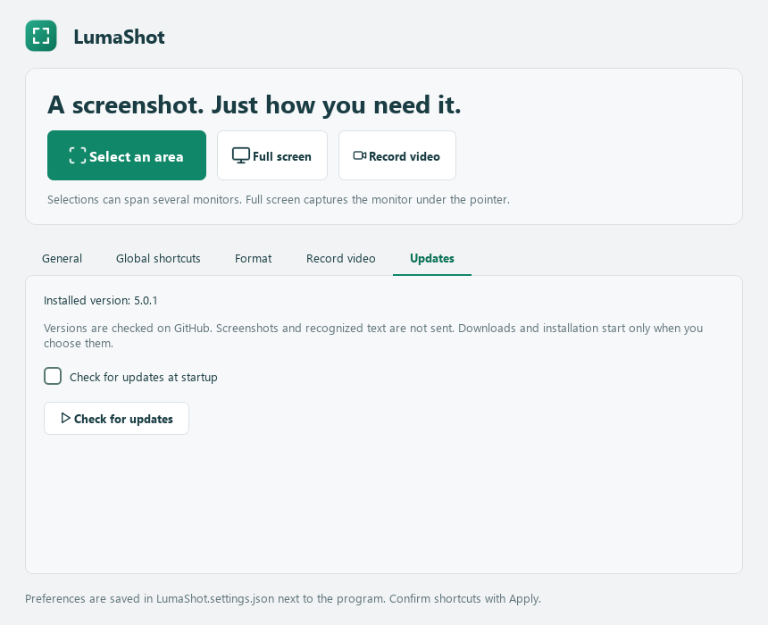

<p align="center">
  
</p>
<h1 align="center">LumaShot</h1>
<p align="center"><strong>A screenshot. Just how you need it.</strong></p>
<p align="center">Select, annotate and record your screen.<br>A compact Windows app with a petrol-green interface, light and dark themes, and three languages.</p>
<p align="center">
  
  
  
  <a href="LICENSE"></a>
  
</p>
<p align="center">
  <strong>English</strong> · <a href="docs/README.ro.md">Română</a> · <a href="docs/README.ru.md">Русский</a>
</p>
<p align="center">
  <a href="https://github.com/TOKKAB1/LumaShot/releases/latest"></a>
</p>
<p align="center">
  <a href="https://github.com/TOKKAB1/LumaShot/archive/refs/heads/main.zip">Download source ZIP</a> ·
  <a href="#run-from-python">Run from Python</a> ·
  <a href="https://github.com/TOKKAB1/LumaShot/issues">Report an issue</a> · <a href="CHANGELOG.md">Changes</a>
</p>


## What you can do

| Screenshots | Screen recording | Make it yours |
|---|---|---|
| Select a region across one or more monitors | Record a selected region to MP4 | Light and dark themes |
| Resize with eight selection handles | Pause and resume the same recording | Romanian, Russian and English |
| Draw, add text, highlight and number steps | Toggle microphone and computer audio independently | Editable global shortcuts |
| Edit annotations with Shift and object handles | Review before saving or discarding | Optional startup with Windows |
| Copy, or save as PNG/JPEG | Save to the default folder or choose a location | Portable JSON preferences |

Captures and OCR stay local. LumaShot has **no account, cloud upload or telemetry**. GitHub is contacted only for a manual or enabled startup update check and an update download you request.

## Install on Windows

Download the latest published Windows installer from [GitHub Releases](https://github.com/TOKKAB1/LumaShot/releases/latest).
Extract the ZIP, if supplied, and run the installer. Python is not required.
The v5 installer is named **LumaShot-Setup-5.0.0-Windows-x64.exe**.
Setup offers RO/RU/EN, per-user installation and an optional desktop shortcut.

## Run from Python

Requires **Windows 10 version 2004+ or Windows 11** and **64-bit Python 3.10+**. Development and local checks used Python 3.14 and PySide6 6.12.0 on Windows.

1. Choose **Code → Download ZIP**, then extract the complete archive to a writable folder.
2. Open a terminal in that folder and run:

```powershell
python -m pip install -r requirements.txt
python LumaShot.py
```

Dependencies are pinned in [requirements.txt](requirements.txt): PySide6 and SoundCard. NumPy and CFFI are installed with SoundCard. Internet is needed to install dependencies; the application itself works locally.

The application lives in **one Python file**. Icons are embedded, so no separate icon package or image folder is needed to run it. You can also download [LumaShot.py](https://github.com/TOKKAB1/LumaShot/raw/refs/heads/main/LumaShot.py) alone and install `PySide6==6.12.0 SoundCard==0.4.6`. Keep the embedded license notices. [LumaShot.ico](LumaShot.ico) is used when building the EXE or assigning a Windows shortcut icon.

<details>
<summary>Use a separate Python environment</summary>

```powershell
python -m venv .venv
.\.venv\Scripts\python.exe -m pip install -r requirements.txt
.\.venv\Scripts\python.exe LumaShot.py
```

</details>

## Capture and annotate

Click **Select an area**, left-click the tray icon or use the area shortcut. Drag a region across one or more displays. The editor opens with **Move / resize** selected, eight selection handles and compact toolbars beside the capture.

Choose pen, line, arrow, rectangle, text, translucent highlight or numbered steps. Click the current color to open the **24-color palette** and stroke-width control. Copy with **Ctrl+C** or save with **Ctrl+S**. **Enter confirms text; it never copies or closes the capture.**


In **Move / resize**, hold **Shift** and click an annotation to select it. Shift-drag the object or its handles to move or resize it. Lines and arrows have editable endpoints; other objects have bounding handles. **Shift + double-click** edits text. The palette and stroke width apply to the selected object; **Shift+Delete** removes it. Undo and redo cover drawing and editing. Handles are omitted from exported images.


| Key | Action |
|---|---|
| `Print Screen` / `Ctrl+Shift+F9` | Default area shortcuts, when available |
| `V` | Move or resize the selection |
| `P` / `L` / `A` / `R` | Pen / line / arrow / rectangle |
| `T` / `H` / `N` | Text / highlight / numbered step |
| `Shift` + drag | Edit a selected annotation in Move / resize |
| `Shift` + double-click | Edit annotation text |
| `Shift+Delete` | Delete the selected annotation |
| `Ctrl+Z` / `Ctrl+Y` | Undo / redo |
| `Ctrl+C` / `Ctrl+S` | Copy / save screenshot |
| `Esc` / right-click | Cancel capture; Esc first cancels active text editing |

**Full screen** captures the monitor under the cursor at native resolution. It opens the editor by default. In **Format**, choose immediate saving to skip the editor for full-screen captures. A region selection can span several monitors; it stays rectangular, including gaps between displays.

## Record, review, then save

1. Choose **Record video** or use its editable shortcut, initially **Ctrl+Shift+F11**.
2. Select a region. The compact bar appears above it; click **Start** or press the video shortcut again.
3. Toggle the microphone and computer audio independently. Both are initially off. Use **Pause / Resume** when needed; paused time is excluded from the saved video.
4. Click **Stop** or press the video shortcut to open the preview. Play, pause, seek or mute the preview without changing the recording.
5. Choose **Save… → Default folder** or **Choose location…**, or **Discard recording**. Canceling the save dialog keeps the draft available. Saving copies the MP4 without re-encoding.


A thin **red border** marks the recording area and becomes amber while paused. The controls remain usable with the mouse. Windows capture exclusion keeps the bar, its tooltips and the border out of the recorded video. If exclusion is unavailable, the border moves outside the region; Start is blocked if the bar cannot be kept out of the video.


Video uses **MP4 / H.264, targeting 20 fps**, at the selected region's native resolution. Odd dimensions are padded by one black pixel. The requested video bitrate scales with the area between 2 and 30 Mb/s; audio targets **AAC stereo, 48 kHz, 256 kb/s**. Actual output depends on the encoder, content and available performance. No separate FFmpeg executable is needed.

Audio uses the default Windows microphone and playback device. After changing devices in Windows, switch the corresponding source off and on. Muted or paused sources release their audio input. Closing the preview asks whether to save or discard; quitting during recording waits for that choice too.

## Extract text from a screenshot

Select a region as usual, then click **Extract text** in the bottom action bar,
beside Copy and Save. There is no extra OCR hotkey. A separate window lets you
review or correct the result. Select part of the text and click **Copy text**,
or leave it unselected to copy everything. Closing that window returns to the
same capture, with its crop and annotations preserved.

The OCR window opens above the capture overlay and receives keyboard focus immediately.





OCR reads the original selected pixels, without the toolbars or your annotations.
It uses Windows' built-in OCR locally through Windows PowerShell; no additional
Python package or OCR executable is needed. Available recognition languages depend
on the OCR language packs installed in Windows, independently of the interface
language. Choose an available language in the OCR window. If no packs are installed,
the app explains how to open Windows language settings. Blurry or small text may
need correction; handwriting and complex layouts are not guaranteed.

## Updates from GitHub

Open **Updates → Check for updates**. Optional checking at startup is **off by
default** and can be enabled there. Only stable releases from TOKKAB1/LumaShot are
used. The application does not download or install without your choice, and no
screenshots, OCR text or personal preferences are sent to GitHub.



When a newer version exists, read its changes and choose **Download update**.
The download is checked against the SHA-256 digest supplied by GitHub. Both an
installer EXE and a ZIP containing that installer are supported. Then choose
**Install and close LumaShot** to open the interactive installer after the app
exits. Finish any capture, recording or unsaved video review first. Closing the
update window cancels a download and removes its temporary files.

This updates the installed Windows application. Python source can still be
downloaded separately. To publish future compatible updates, see the
[maintainer's update guide](docs/UPDATES.md).

## Preferences and tray

| Tab | Options |
|---|---|
| General | Language, light/dark theme, startup with Windows, notifications, remembered area, cursor inclusion, capture folder |
| Global shortcuts | Independently enable, disable and change area, full-screen and video shortcuts |
| Format | PNG/JPEG, JPEG quality 1–100, full-screen editing or immediate save |
| Record video | Default microphone and computer-audio switches |
| Updates | Manual checking and optional startup checks for GitHub releases |

Preferences save automatically; confirm shortcut changes with **Apply**. The full-screen shortcut starts disabled, with `Ctrl+Shift+F10` suggested. Occupied shortcuts produce an error while the previous working combination is retained.

**Left-click the tray icon:** select a region. **Right-click:** area capture, full screen, video, open LumaShot or quit. During recording, video becomes Stop and review, and screenshot actions are disabled. Closing the main window keeps the app in the tray when available; use **Quit** to exit completely. A second launch opens the existing instance.

Settings are stored atomically in **LumaShot.settings.json beside the script or EXE**. Keep that folder writable. Do not commit your personal JSON. Older Windows settings migrate on first launch without a JSON; a damaged JSON is preserved for recovery. Remembered regions are reused only for a matching display layout.

**Start with Windows** is optional and off by default. It starts LumaShot in the tray at sign-in. After moving the application or its Python environment, turn the option off and on to update its path.

<details>
<summary>Dark theme</summary>


</details>

## Current limits

- Windows only. Mixed-DPI layouts, HDR, physical audio devices and device permissions need checking on the target PC. Very large regions depend on encoder limits and performance.
- Protected video/audio may not be capturable. Scrolling capture, automatic window selection and magnifier/zoom are not included.
- Recordings stay in temporary storage until saved or discarded; the preview is not a crash-recovery system.
- Windows clipboard history or cloud sync, if enabled, is managed by Windows.

Qt/FFmpeg may print codec discovery messages about unavailable AV1 encoders even when recording with H.264, or `track 0: codec frame size is not set`. These messages alone do not indicate a failed recording. Actual recording errors are shown in the app. The built EXE opens without a console.

## License

Original LumaShot code, documentation and app artwork are under the [MIT license](LICENSE), copyright © 2026 TOKKAB1. Use, modification and redistribution, including commercial use, are allowed with the license and copyright notice retained.

Embedded [Lucide](https://lucide.dev/) icons retain their ISC/MIT notices. PySide6/Qt, SoundCard and other dependencies retain their own licenses; LumaShot's MIT license does not replace them. See [THIRD_PARTY_NOTICES.md](THIRD_PARTY_NOTICES.md).

LumaShot is an independent project inspired by the capture workflow of Lightshot and annotation tools of Greenshot. It does not include their code, branding or binaries and is not affiliated with either project.
