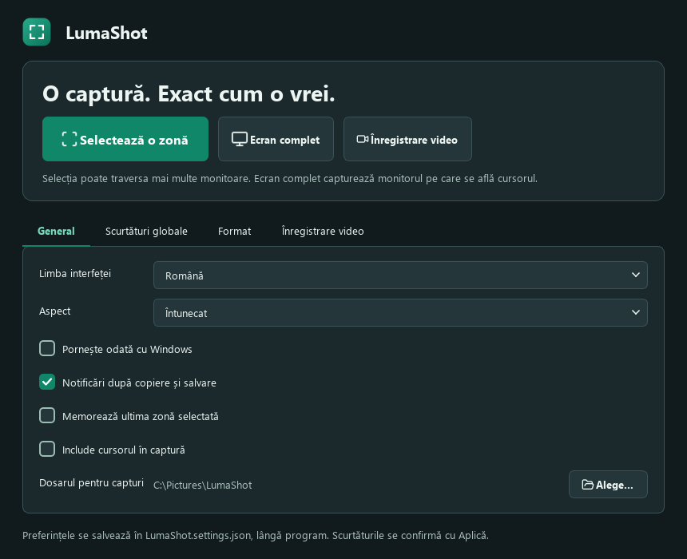
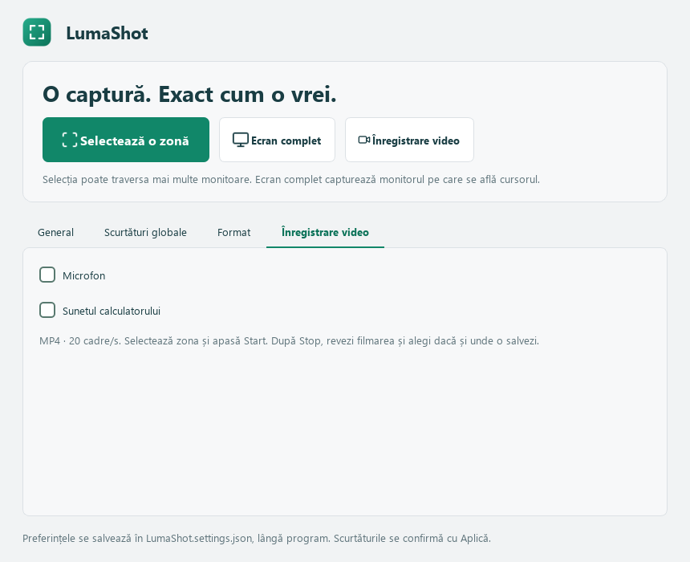
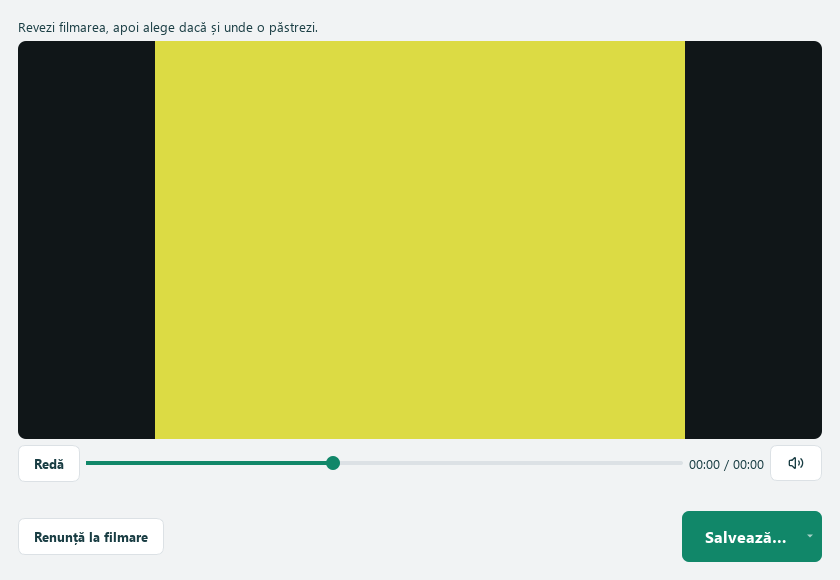

# LumaShot

**O captură. Exact cum o vrei.**

[English](../README.md) · **Română** · [Русский](README.ru.md)

Aplicație pentru Windows, scrisă în Python + PySide6. Selectezi o zonă, adaugi explicații și copiezi sau salvezi imaginea. Interfața este disponibilă în **română, rusă și engleză**, iar limba aleasă se păstrează.


## Pornire

Ai nevoie de Windows 10 (2004+) sau Windows 11, Python 3.10 sau mai nou, PySide6 și SoundCard. NumPy și CFFI se instalează automat împreună cu SoundCard. Descarcă [LumaShot.py](https://github.com/TOKKAB1/LumaShot/raw/refs/heads/main/LumaShot.py) și rulează din dosarul său:

```powershell
python -m pip install PySide6==6.12.0 SoundCard==0.4.6
python LumaShot.py
```

Aplicația este într-un singur fișier Python. Pentru versiunea fără Python, folosește arhiva Windows portabilă furnizată, extrage tot dosarul și pornește **LumaShot.exe**. Păstrează dosarul `_internal` lângă executabil. Poți construi propria versiune cu [build_exe.bat](../build_exe.bat), urmând [instrucțiunile](BUILD.md). Fișierul [LumaShot.ico](../LumaShot.ico) este opțional și poate fi folosit pentru pictograma unei scurtături Windows.

## Utilizare

Apasă **Selectează o zonă**, **Print Screen** sau **Ctrl+Shift+F9**. Trasează zona dorită și folosește bara de instrumente care apare lângă selecție.

| Tastă | Funcție |
|---|---|
| `V` | Mutarea selecției și redimensionarea din cele patru colțuri sau mijloacele laturilor |
| `P`, `L`, `A` | Creion, linie, săgeată |
| `R` | Dreptunghi |
| `T` | Text; Enter îl confirmă |
| `H`, `N` | Evidențiere, număr de pas |
| `Ctrl+Z`, `Ctrl+Y` | Anulează, refă adnotarea |
| `Ctrl+C` | Copiază imaginea |
| `Ctrl+S` | Salvează în PNG sau JPEG |
| `Esc` sau clic dreapta | Anulează captura |

În timpul introducerii textului, Esc renunță mai întâi la acel text. Adnotările rămân ancorate la ecran atunci când muți selecția.

Poți alege dosarul de salvare și scurtătura din filele **General** și **Scurtături globale**. Pentru o scurtătură personalizată, apasă în câmpul dedicat, tastează combinația dorită și apasă **Aplică**. Alegerea înlocuiește scurtăturile implicite și se păstrează între porniri. Dacă noua combinație este ocupată, cea anterioară rămâne activă. Dacă scurtătura salvată nu mai este disponibilă la pornire, folosește butonul de captură și alege alta.

Editorul pornește cu **Mută / redimensionează** selectat. Bara de unelte este verticală și compactă, cu acțiunile într-un rând dedesubt. Apasă pe culoarea curentă pentru paleta cu **24 de culori** și reglajul grosimii liniei. Paleta se închide după alegere, fără un buton sau dialog separat „Altă culoare”. Elipsa și mascarea au fost scoase din bară și din scurtăturile editorului.

**Enter nu copiază și nu închide captura.** Confirmă doar textul unei adnotări în curs de scriere. Pentru copiere folosește **Ctrl+C** sau butonul Copiază.

Pictogramele [Lucide](https://lucide.dev/) sunt incluse în fișierul Python și reutilizate după prima randare. Nu necesită internet sau un pachet suplimentar. Licențele sunt păstrate în [notificările pentru componente terțe](../THIRD_PARTY_NOTICES.md) și în script.

## Setări și ecran complet

- **General:** limba, tema luminoasă/întunecată, notificările, memorarea zonei, includerea cursorului și dosarul de salvare.
- **Scurtături globale:** activezi sau dezactivezi separat scurtătura pentru zonă și pentru ecran complet. Tastează combinația și apasă **Aplică**. Scurtătura pentru ecran complet pornește dezactivată; propunerea este `Ctrl+Shift+F10`. Butoanele rămân disponibile.
- **Format:** PNG/JPEG, calitatea JPEG între 1 și 100 și comportamentul capturii complete.

**Ecran complet** capturează monitorul pe care se află cursorul, la rezoluția sa nativă. Inițial deschide editorul cu tot monitorul selectat. Poți alege **Salvează imediat în dosar** pentru salvare directă, fără editor sau dialog. Setarea se aplică butonului și scurtăturii pentru ecran complet.

Setările generale și de format se păstrează automat; scurtăturile se confirmă cu **Aplică**. Ultima zonă se memorează după copiere sau salvare și se restaurează pe același monitor. O captură completă nu înlocuiește zona memorată.

Clicul stâng pe pictograma de lângă ceas pornește selectarea unei zone. Clicul drept oferă **Selectează o zonă**, **Ecran complet**, **Înregistrare video**, **Deschide LumaShot** și **Ieșire**. În timpul înregistrării, opțiunea video devine **Oprește și salvează**, iar capturile foto sunt dezactivate. Capturile rămân locale.



## Pictograma de lângă ceas

Închiderea ferestrei păstrează aplicația în zona de notificări, când aceasta este disponibilă. Pentru închiderea completă, apasă clic dreapta pe pictograma verde petrol și alege **Ieșire**.

Pentru a vedea schimbările după înlocuirea fișierului Python, închide mai întâi aplicația din acest meniu, apoi pornește noul fișier. O a doua pornire, cât timp aplicația rulează, redeschide instanța existentă.

## Setări portabile, mai multe monitoare și video



Programul creează **LumaShot.settings.json** lângă fișierul Python și salvează automat preferințele în el. Păstrează aplicația într-un dosar în care ai drept de scriere. La prima pornire fără JSON se preiau setările vechi din Windows. Un JSON deteriorat este păstrat cu sufixul `.damaged-…`, iar aplicația afișează o avertizare. Nu încărca JSON-ul personal pe GitHub.

Selecția unei imagini sau a unui video poate traversa monitoarele. Se păstrează pixelii nativi ai desktopului; golurile dintre ecrane rămân în dreptunghiul capturat. Butonul **Ecran complet** rămâne dedicat monitorului de sub cursor. Zona memorată care traversează monitoarele se restaurează doar pentru aceeași configurație a desktopului.

În fila **Înregistrare video**, alege separat **Microfon** și **Sunetul calculatorului**. Ambele sunt inițial oprite, iar alegerile se păstrează. Apasă **Înregistrare video** sau **Ctrl+Shift+F11** și selectează zona. Deasupra ei apare o bară compactă: **Start**, cronometru, microfon, sunetul calculatorului și **×**. Apasă Start; aceeași bară rămâne acolo, iar butonul devine **Stop**. Sunetele se pot comuta înainte și în timpul înregistrării, cu pictograme și tooltipuri pentru starea curentă.

**Stop** deschide previzualizarea filmării. **×** anulează înainte de pornire; în timpul înregistrării oprește și deschide aceeași previzualizare. Alege **Salvează… → În dosarul implicit** sau **Alege locația…**, ori renunță la filmare. Opțiunea video din tray devine oprire/previzualizare; ieșirea așteaptă alegerea ta.

Video: MP4 cu H.264/AAC, țintă 20 cadre/s, rezoluția zonei alese; dimensiunile impare primesc un pixel negru suplimentar. Nu este necesar un executabil FFmpeg separat. Se folosesc microfonul și dispozitivul de redare implicite din Windows; după schimbarea dispozitivului în Windows, oprește și repornește comutatorul respectiv. Oprirea microfonului eliberează intrarea audio. Sunetele dezactivate produc liniște în pistă.

Bara este poziționată deasupra selecției; la marginea ecranului intră în interiorul zonei. Rămâne clicabilă, dar Windows exclude bara și tooltipurile ei din video. Dacă excluderea nu este disponibilă și bara ar intra în filmare, Start este blocat cu o explicație; poți alege o zonă care lasă spațiu deasupra. Zonele foarte mari depind de encoder și de performanța PC-ului. Erorile sunt afișate; un fișier parțial nu este raportat ca video salvat corect.

**Scurtături globale → Selectare / Start / Stop video** permite modificarea sau dezactivarea independentă a scurtăturii video. Implicit este **Ctrl+Shift+F11**: selectare, apoi încă o apăsare pentru Start, iar în timpul filmării pentru Stop și previzualizare. Conflictele păstrează scurtătura anterioară. Lupa/zoomul rămâne pentru o versiune ulterioară.

Verificările video și audio folosesc imagini și tonuri generate. Microfonul real, permisiunile Windows, dispozitivul de redare și monitoarele cu scalări diferite trebuie verificate pe calculatorul utilizatorului.

## Mesajele din consolă

Qt/FFmpeg poate afișa mesaje de verificare a codecurilor, inclusiv lipsa unui encoder AV1, deși aplicația înregistrează cu H.264. Mesajul `track 0: codec frame size is not set` poate apărea din motorul audio; testele verifică imaginea și sunetul din MP4-ul finalizat. Aceste mesaje, singure, nu înseamnă că filmarea a eșuat. Erorile reale de înregistrare sunt afișate în aplicație.

Avertismentul despre `setFrameRate()` a fost corectat folosind `setStreamFrameRate()`, conform [documentației Qt](https://doc.qt.io/qtforpython-6/PySide6/QtMultimedia/QVideoFrameFormat.html).

## Confidențialitate și limite

Aplicația nu trimite capturi pe internet și nu cere cont. Salvarea produce o imagine cu adnotările aplicate, fără originalul ascuns sau istoricul editării.

Clipboardul este cel standard Windows. Istoricul și sincronizarea sa, dacă sunt activate, sunt gestionate de Windows.

- Selecția poate traversa mai multe monitoare. Golurile dintre monitoare rămân în imaginea dreptunghiulară; configurațiile cu scalări diferite necesită verificări suplimentare pe hardware.
- OCR, capturile cu derulare și selectarea automată a ferestrelor nu sunt incluse.
- Dacă o scurtătură este ocupată de alt program, folosește una dintre cele afișate sau butonul pentru captură.
- Monitoarele HDR și conținutul video protejat nu au fost validate.
- Programul nu se adaugă automat la pornirea Windows.

Cele 65 de teste locale verifică desenarea, selecția, traducerile, exportul, bara compactă, scurtăturile, JSON-ul și video/audio cu surse generate. Dezvoltarea a fost verificată pe Windows cu Python 3.14 și PySide6 6.12.0.

[Raportează o problemă](https://github.com/TOKKAB1/LumaShot/issues) · [Înapoi la proiect](../README.md)

## Licență și contribuții

Codul original LumaShot, documentația și pictograma verde petrol a aplicației sunt publicate sub [licența MIT](../LICENSE), cu notificarea `Copyright (c) 2026 TOKKAB1`. Oricine le poate folosi, modifica și redistribui, inclusiv comercial, păstrând licența și notificarea de autor. Licența este inclusă și în fișierul Python.

Pictogramele Lucide păstrează licențele ISC/MIT. PySide6 și Qt se instalează separat și au propriile licențe, care nu sunt înlocuite de MIT. Vezi [notificările componentelor terțe](../THIRD_PARTY_NOTICES.md).

Proiectul este independent de Lightshot și Greenshot și nu include codul, logo-urile sau executabilele lor. Pentru întregul proiect, folosește **Code → Download ZIP** pe GitHub. Contribuțiile sunt binevenite: [ghid de contribuție](../CONTRIBUTING.md).


## Îmbunătățiri video în 0.3.0

Butonul **Pauză / Continuă** oprește temporar imaginea, sunetul și cronometrul.
Continuarea păstrează același MP4, fără timpul petrecut în pauză. Poți apăsa Stop
și când filmarea este în pauză.

Conturul roșu arată zona înregistrată și devine galben în pauză. Clicurile trec
prin el, iar Windows îl exclude din captură. Dacă excluderea nu este disponibilă,
conturul este mutat în afara zonei; la marginea monitorului poate fi parțial sau
complet în afara ecranului.

Sunetul se salvează în AAC stereo, 48 kHz, cu țintă explicită de 256 kb/s.
Preluarea folosește un buffer mai mare și tolerează întârzieri scurte fără să
schimbe timpii audio. Testele verifică separarea stereo și frecvențe de 12 kHz
în MP4-ul decodat. Configurațiile reale de sunet trebuie verificate și pe
calculatorul utilizatorului.

Mesajele de verificare a codecurilor Qt pot apărea în terminal. Comportamentul
Ctrl+C rămâne neschimbat; executabilul pornește fără consolă.


## Pornire cu Windows, previzualizare și editarea obiectelor

În **General → Pornește odată cu Windows**, poți activa sau dezactiva pornirea
automată pentru utilizatorul curent. Implicit este oprită. Aplicația pornește în
tray la conectare. Pentru versiunea Python, păstrează scriptul și mediul Python
în aceleași locuri. După mutarea programului, oprește și repornește opțiunea
pentru a actualiza calea.

După Stop apare o fereastră pentru redare, pauză, derulare și sunetul
previzualizării. **Salvează…** oferă **În dosarul implicit** și **Alege locația…**.
Anularea dialogului păstrează filmarea deschisă. Fișierul MP4 se copiază fără
recodare; dacă salvarea eșuează, originalul rămâne disponibil pentru reîncercare.
**Renunță la filmare** șterge ciorna nesalvată. Închiderea ferestrei cere o alegere;
ieșirea în timpul filmării așteaptă aceeași decizie. Locația personalizată nu
schimbă dosarul implicit. Filmarea se păstrează temporar până alegi ce faci cu ea.



În modul **Mută / redimensionează (V)**, ține **Shift** și apasă pe un obiect pentru
a-l selecta. Cu Shift apăsat, trage obiectul sau mânerele sale pentru mutare și
redimensionare. Liniile și săgețile au capete editabile; celelalte desene și textul
au mânere pe contur. **Shift + dublu clic** pe text permite rescrierea lui;
Enter confirmă, Esc renunță la modificare. Paleta și grosimea se aplică obiectului
selectat. **Shift+Delete** îl șterge. **Ctrl+Z / Ctrl+Y** anulează și refac
desenarea și modificările. Un clic obișnuit revine la ajustarea zonei de captură.
Mânerele nu apar în imaginea salvată.
