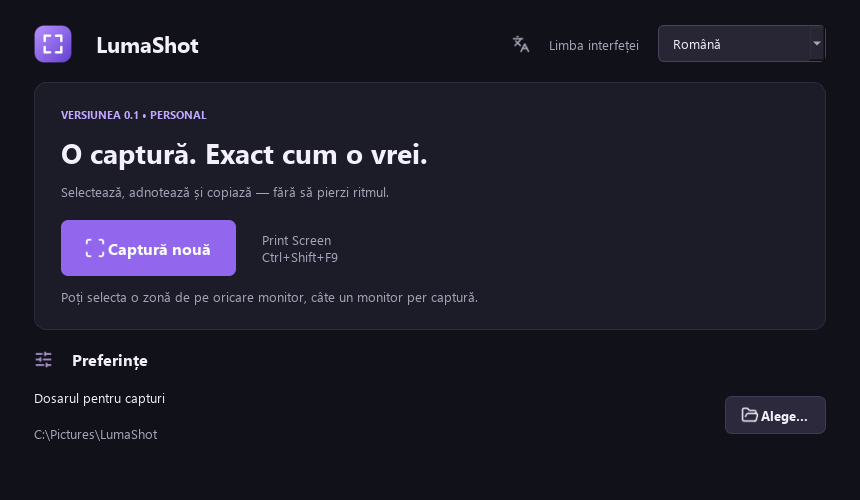

# LumaShot

**O captură. Exact cum o vrei.**

[English](../README.md) · **Română** · [Русский](README.ru.md)

Aplicație pentru Windows, scrisă în Python + PySide6. Selectezi o zonă, adaugi explicații și copiezi sau salvezi imaginea. Interfața este disponibilă în **română, rusă și engleză**, iar limba aleasă se păstrează.



## Pornire

Ai nevoie de Windows, Python 3.10 sau mai nou și PySide6. Descarcă [LumaShot.py](https://github.com/TOKKAB1/LumaShot/raw/refs/heads/main/LumaShot.py) și rulează din dosarul său:

```powershell
python -m pip install PySide6==6.12.0
python LumaShot.py
```

Aplicația este într-un singur fișier Python. Nu există încă o versiune `.exe`. Fișierul [LumaShot.ico](../LumaShot.ico) este opțional și poate fi folosit pentru pictograma unei scurtături Windows.

## Utilizare

Apasă **Captură nouă**, **Print Screen** sau **Ctrl+Shift+F9**. Trasează zona dorită și folosește bara de instrumente care apare lângă selecție.

| Tastă | Funcție |
|---|---|
| `V` | Mutarea selecției și redimensionarea din colțuri |
| `P`, `L`, `A` | Creion, linie, săgeată |
| `R`, `E` | Dreptunghi, elipsă |
| `T` | Text; Enter îl confirmă |
| `H`, `M`, `N` | Evidențiere, mască opacă, număr de pas |
| `Ctrl+Z`, `Ctrl+Y` | Anulează, refă adnotarea |
| `Ctrl+C` sau `Enter` | Copiază imaginea |
| `Ctrl+S` | Salvează în PNG sau JPEG |
| `Esc` sau clic dreapta | Anulează captura |

În timpul introducerii textului, Esc renunță mai întâi la acel text. Adnotările rămân ancorate la ecran atunci când muți selecția.

Poți alege dosarul de salvare din **Preferințe**. Fereastra principală rămâne simplă: captură, limbă și dosar.

Pictogramele [Lucide](https://lucide.dev/) sunt incluse în fișierul Python și reutilizate după prima randare. Nu necesită internet sau un pachet suplimentar. Licențele sunt păstrate în [notificările pentru componente terțe](../THIRD_PARTY_NOTICES.md) și în script.

## Pictograma de lângă ceas

Închiderea ferestrei păstrează aplicația în zona de notificări, când aceasta este disponibilă. Pentru închiderea completă, apasă clic dreapta pe pictograma mov și alege **Ieșire**.

Pentru a vedea schimbările după înlocuirea fișierului Python, închide mai întâi aplicația din acest meniu, apoi pornește noul fișier. O a doua pornire, cât timp aplicația rulează, redeschide instanța existentă.

## Confidențialitate și limite

Aplicația nu trimite capturi pe internet și nu cere cont. Salvarea produce o imagine cu adnotările aplicate, fără originalul ascuns sau istoricul editării. Mascarea înlocuiește complet pixelii acoperiți; acoperă întreaga informație pe care vrei să o ascunzi.

Clipboardul este cel standard Windows. Istoricul și sincronizarea sa, dacă sunt activate, sunt gestionate de Windows.

- O captură poate acoperi o zonă de pe un singur monitor.
- OCR, capturile cu derulare și selectarea automată a ferestrelor nu sunt incluse.
- Dacă o scurtătură este ocupată de alt program, folosește una dintre cele afișate sau butonul pentru captură.
- Monitoarele HDR și conținutul video protejat nu au fost validate.
- Programul nu se adaugă automat la pornirea Windows.

Cele 10 teste locale verifică desenarea, selecția, traducerile și exportul. Dezvoltarea a fost verificată pe Windows cu Python 3.14 și PySide6 6.12.0.

[Raportează o problemă](https://github.com/TOKKAB1/LumaShot/issues) · [Înapoi la proiect](../README.md)
