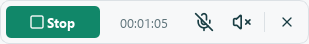
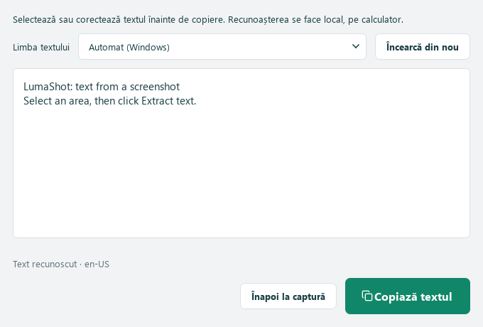
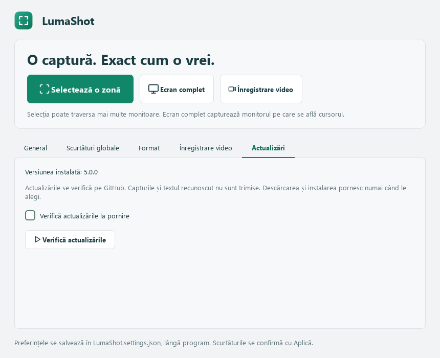

# LumaShot

**O captură. Exact cum o vrei.**

[English](../README.md) · **Română** · [Русский](README.ru.md)

Aplicație pentru Windows cu selecție pe mai multe monitoare, adnotări și înregistrare video. Versiunea **v5 (5.0.0)** include teme luminoasă și întunecată în verde petrol, interfață RO/RU/EN și setări portabile. Capturile rămân locale: fără cont, încărcare online sau telemetrie.


## Instalare pe Windows

[**Descarcă pentru Windows**](https://github.com/TOKKAB1/LumaShot/releases/latest)

Descarcă installerul publicat în Releases și extrage ZIP-ul, dacă este cazul.
Pentru v5, fișierul se numește **LumaShot-Setup-5.0.0-Windows-x64.exe**.
Nu ai nevoie de Python. Instalarea este disponibilă în RO/RU/EN, pentru
utilizatorul curent, cu scurtătură opțională pe desktop.

## Pornire din Python

Ai nevoie de **Windows 10 versiunea 2004+ sau Windows 11** și **Python 3.10+ pe 64 de biți**.

1. Descarcă proiectul din **Code → Download ZIP** și extrage-l într-un dosar în care poți scrie.
2. Deschide Terminal în acel dosar și rulează:

```powershell
python -m pip install -r requirements.txt
python LumaShot.py
```

Bibliotecile PySide6 și SoundCard sunt indicate în [requirements.txt](../requirements.txt). NumPy și CFFI se instalează împreună cu SoundCard. Ai nevoie de internet la instalarea lor; aplicația funcționează local.

Programul este într-un singur fișier **LumaShot.py**, cu pictogramele incluse. Poți descărca și [doar scriptul](https://github.com/TOKKAB1/LumaShot/raw/refs/heads/main/LumaShot.py), apoi instala `PySide6==6.12.0 SoundCard==0.4.6`. Păstrează notificările de licență din el. Fișierul ICO este opțional pentru rularea Python.

## Capturi și adnotări

Apasă **Selectează o zonă**, fă clic stâng pe pictograma din tray sau folosește scurtătura pentru zonă. Selecția poate traversa mai multe monitoare și are **8 mânere** pentru redimensionare. Editorul pornește în **Mută / redimensionează**.

Ai creion, linie, săgeată, dreptunghi, text, evidențiere și pași numerotați. Apasă culoarea curentă pentru **paleta cu 24 de culori** și reglajul grosimii. **Ctrl+C** copiază; **Ctrl+S** salvează PNG/JPEG. **Enter confirmă textul și nu copiază sau închide captura.**


În modul Mută / redimensionează, ține **Shift** și apasă un obiect pentru selectare. Cu Shift apăsat, trage obiectul sau mânerele pentru mutare/redimensionare. Liniile și săgețile au capete editabile. **Shift + dublu clic** modifică textul; **Shift+Delete** șterge obiectul selectat. Paleta și grosimea se aplică selecției. **Ctrl+Z / Ctrl+Y** anulează și refac desenarea și modificările. Mânerele nu apar în imaginea exportată.

| Tastă | Acțiune |
|---|---|
| `Print Screen` / `Ctrl+Shift+F9` | Scurtături implicite pentru zonă, dacă sunt disponibile |
| `V` | Mută / redimensionează |
| `P` / `L` / `A` / `R` | Creion / linie / săgeată / dreptunghi |
| `T` / `H` / `N` | Text / evidențiere / pas numerotat |
| `Shift` + tragere | Modifică obiectul selectat în modul Mută / redimensionează |
| `Shift` + dublu clic | Editează textul |
| `Shift+Delete` | Șterge obiectul selectat |
| `Ctrl+Z` / `Ctrl+Y` | Anulează / refă |
| `Ctrl+C` / `Ctrl+S` | Copiază / salvează imaginea |
| `Esc` / clic dreapta | Anulează captura; Esc renunță mai întâi la textul în curs |

**Ecran complet** capturează monitorul de sub cursor, la rezoluția nativă. Implicit deschide editorul; în **Format** poți alege salvarea imediată în dosarul implicit. Pentru mai multe monitoare într-o singură imagine folosește selectarea unei zone. Dreptunghiul include și golurile dintre ecrane.

## Înregistrare, previzualizare și salvare

1. Apasă **Înregistrare video** sau scurtătura sa, implicit **Ctrl+Shift+F11**.
2. Selectează zona. Apare bara compactă deasupra ei; apasă **Start** sau încă o dată scurtătura video.
3. Comută separat microfonul și sunetul calculatorului. Ambele sunt inițial oprite. **Pauză / Continuă** păstrează același MP4 și elimină timpul petrecut în pauză.
4. Apasă **Stop** sau scurtătura video pentru previzualizare. Poți reda, pune pe pauză, derula și opri sunetul previzualizării.
5. Alege **Salvează… → În dosarul implicit** sau **Alege locația…**, ori **Renunță la filmare**. Anularea dialogului păstrează ciorna deschisă. Salvarea copiază MP4-ul fără recodare.



Un **contur roșu** arată zona filmată și devine galben în pauză. Bara și tooltipurile rămân utilizabile cu mouse-ul, dar Windows le exclude din video împreună cu acel contur. Dacă excluderea nu este disponibilă, conturul se mută în exterior; Start este blocat dacă bara ar apărea în filmare.


Video: **MP4 / H.264, țintă 20 cadre/s**, la rezoluția zonei alese. Dimensiunile impare primesc un pixel negru suplimentar. Bitrate-ul video solicitat variază cu suprafața între 2 și 30 Mb/s; sunetul are țintă **AAC stereo, 48 kHz, 256 kb/s**. Rezultatul depinde de encoder, conținut și performanța PC-ului. Nu este necesar un executabil FFmpeg separat.

Se folosesc dispozitivele implicite Windows. După schimbarea unui dispozitiv în Windows, oprește și repornește comutatorul său din bară. Oprirea unei surse sau pauza eliberează intrarea audio. Închiderea previzualizării cere o decizie; ieșirea în timpul înregistrării așteaptă aceeași alegere. Filmările sunt temporare până le salvezi.

## Text din captură (OCR)

Selectează zona ca de obicei, apoi apasă **Extrage textul** din bara de jos, lângă
Copiază și Salvează. Nu este necesară o scurtătură OCR. Fereastra nouă permite
verificarea și corectarea rezultatului. Selectează doar o parte și apasă
**Copiază textul**, sau nu selecta nimic pentru copierea întregului text.
Închiderea ferestrei te întoarce la aceeași captură și păstrează adnotările.

Fereastra OCR se deschide deasupra capturii și primește imediat focusul tastaturii.



Se recunosc pixelii originali ai zonei, fără bare sau desene adăugate. Procesarea
este locală, folosind OCR-ul Windows prin Windows PowerShell, fără biblioteci
Python noi. Limbile de recunoaștere depind de pachetele OCR instalate în Windows,
independent de limba interfeței. Poți alege limba din fereastră; dacă nu există
pachete, primești explicația și un buton către setările de limbă Windows.
Textul neclar sau mic poate necesita corectare; scrisul de mână și aranjamentele
complexe nu sunt garantate.

## Actualizări de pe GitHub

În **Actualizări**, apasă **Verifică actualizările**. Verificarea la pornire este
opțională și implicit oprită. Se folosesc doar versiunile stabile din
TOKKAB1/LumaShot; capturile, textul OCR și setările personale nu sunt trimise.



Când există o versiune mai nouă, vezi modificările și poți alege **Descarcă
actualizarea**. Fișierul se verifică folosind suma SHA-256 furnizată de GitHub.
Sunt acceptate installerul EXE sau un ZIP care îl conține. Apoi **Instalează și
închide LumaShot** pornește installerul interactiv după închiderea aplicației.
Încheie mai întâi captura sau filmarea și salvează ori renunță la ciornă.
Închiderea ferestrei anulează descărcarea și șterge fișierele temporare.

Funcția actualizează aplicația Windows instalată; sursa Python rămâne disponibilă
separat. Pentru publicarea actualizărilor viitoare vezi [ghidul](UPDATES.md).

## Setări și tray

| Filă | Opțiuni |
|---|---|
| General | Limbă, temă, pornire cu Windows, notificări, memorarea zonei, cursor, dosar |
| Scurtături globale | Activare/dezactivare și combinații independente pentru zonă, ecran complet și video |
| Format | PNG/JPEG, calitate JPEG 1–100, editor sau salvare imediată pentru ecran complet |
| Înregistrare video | Preferințe separate pentru microfon și sunetul calculatorului |
| Actualizări | Verificare manuală și opțională la pornire pentru versiuni de pe GitHub |

Setările se salvează automat; scurtăturile se confirmă cu **Aplică**. Scurtătura pentru ecran complet este inițial dezactivată, cu propunerea `Ctrl+Shift+F10`. Dacă o combinație este ocupată, aplicația păstrează combinația anterioară funcțională.

**Clic stâng pe tray:** selectarea unei zone. **Clic drept:** zonă, ecran complet, video, deschiderea aplicației și ieșire. În timpul filmării, opțiunea video devine oprire/previzualizare, iar capturile foto sunt dezactivate. Închiderea ferestrei principale păstrează aplicația în tray când este disponibil; **Ieșire** o închide complet. O a doua pornire deschide instanța existentă.

Preferințele se scriu în **LumaShot.settings.json lângă script sau EXE**. Dosarul trebuie să permită scrierea. Nu încărca JSON-ul personal pe GitHub. Setările vechi se migrează la prima pornire fără JSON; un fișier deteriorat este păstrat pentru recuperare. Zona memorată se restaurează pentru aceeași configurație a monitoarelor.

**Pornește odată cu Windows** este opțional și implicit oprit. Aplicația pornește în tray la conectare. După mutarea aplicației sau a mediului Python, oprește și repornește opțiunea pentru actualizarea căii.

<details>
<summary>Tema întunecată</summary>


</details>

## Limite și verificări

- Doar Windows. Monitoarele cu scalări diferite, HDR, dispozitivele audio și permisiunile trebuie verificate pe PC-ul folosit. Zonele foarte mari depind de encoder și performanță.
- Capturile cu derulare, selectarea automată a ferestrelor și lupa/zoomul nu sunt incluse. Conținutul protejat poate să nu fie capturabil.
- Previzualizarea nu este un sistem de recuperare a filmării după o închidere neașteptată.
- Istoricul și sincronizarea clipboardului, dacă sunt activate, sunt gestionate de Windows.

Qt/FFmpeg poate afișa mesaje despre codecuri AV1 indisponibile chiar când folosește H.264, sau `track 0: codec frame size is not set`. Aceste mesaje, singure, nu indică o filmare eșuată. Erorile reale sunt afișate în aplicație. EXE-ul pornește fără consolă.

## Licență

Codul original, documentația și pictograma aplicației sunt sub [licența MIT](../LICENSE), © 2026 TOKKAB1. Le poți folosi, modifica și redistribui, inclusiv comercial, păstrând licența și notificarea de autor.

Lucide păstrează licențele ISC/MIT; PySide6/Qt, SoundCard și celelalte biblioteci au propriile licențe. Vezi [notificările componentelor terțe](../THIRD_PARTY_NOTICES.md). Proiectul este independent de Lightshot și Greenshot și nu include codul, logo-urile sau executabilele lor.

[Raportează o problemă](https://github.com/TOKKAB1/LumaShot/issues)
