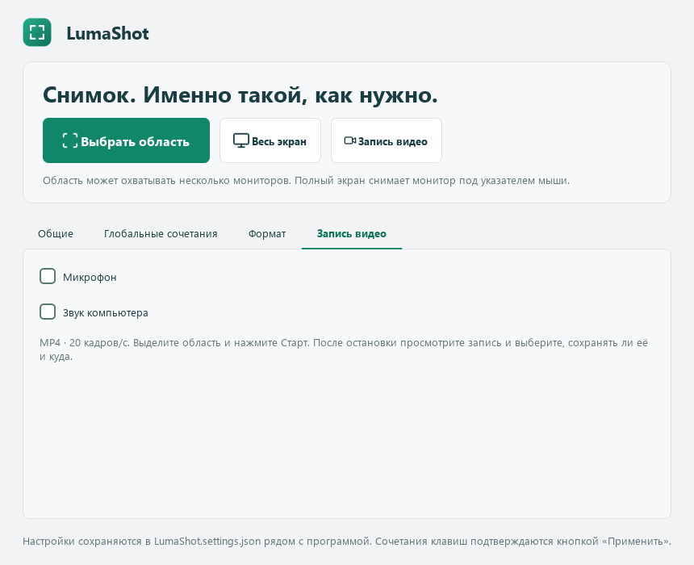

# LumaShot

**Снимок. Именно такой, как нужно.**

[English](../README.md) · [Română](README.ro.md) · **Русский**

Приложение для Windows на Python и PySide6. Выделите область экрана, добавьте пометки и скопируйте или сохраните изображение. Интерфейс доступен на **румынском, русском и английском**. Выбранный язык сохраняется.


## Запуск

Нужны Windows 10 (2004+) или Windows 11, Python 3.10 или новее, PySide6 и SoundCard. NumPy и CFFI устанавливаются автоматически вместе с SoundCard. Скачайте [LumaShot.py](https://github.com/TOKKAB1/LumaShot/raw/refs/heads/main/LumaShot.py) и выполните в папке файла:

```powershell
python -m pip install PySide6==6.12.0 SoundCard==0.4.6
python LumaShot.py
```

Всё приложение находится в одном Python-файле. Версия без Python поставляется в переносимом архиве Windows: распакуйте весь ZIP и запустите **LumaShot.exe**, сохранив рядом папку `_internal`. Для собственной сборки используйте [build_exe.bat](../build_exe.bat) и [инструкцию](BUILD.md). Файл [LumaShot.ico](../LumaShot.ico) необязателен: его можно использовать как значок ярлыка Windows.

## Использование

Нажмите **Выбрать область**, **Print Screen** или **Ctrl+Shift+F9**. Выделите область мышью и выберите инструмент на панели рядом с ней.

| Клавиша | Действие |
|---|---|
| `V` | Переместить область или изменить размер за четыре угла или середины сторон |
| `P`, `L`, `A` | Карандаш, линия, стрелка |
| `R` | Прямоугольник |
| `T` | Текст; Enter подтверждает ввод |
| `H`, `N` | Выделение цветом, номер шага |
| `Ctrl+Z`, `Ctrl+Y` | Отменить, повторить пометку |
| `Ctrl+C` | Скопировать изображение |
| `Ctrl+S` | Сохранить в PNG или JPEG |
| `Esc` или правая кнопка мыши | Отменить снимок |

При вводе текста Esc сначала отменяет этот текст. При перемещении области пометки остаются на исходных местах экрана.

Папку сохранения и сочетание клавиш можно выбрать в **Настройках**. Нажмите на поле сочетания, введите нужную комбинацию и нажмите **Применить**. Она заменит стандартные сочетания и сохранится после перезапуска. Если комбинация занята, прежняя останется активной. Если сохранённое сочетание недоступно при запуске, используйте кнопку создания снимка и выберите другое.

Редактор запускается с выбранным инструментом **Переместить / изменить область**. Компактная панель инструментов расположена вертикально рядом с выделением, а действия — в ряд под ним. Нажмите на текущий цвет, чтобы открыть палитру из **24 цветов** и настройку толщины линии. После выбора цвета палитра закроется. Отдельной кнопки или диалога «Другой цвет» нет. Эллипс и маска убраны из панели и сочетаний редактора.

**Enter не копирует и не закрывает снимок.** Клавиша подтверждает только вводимую текстовую пометку. Для копирования используйте **Ctrl+C** или кнопку копирования.

Значки [Lucide](https://lucide.dev/) встроены в Python-файл и повторно используются после первой отрисовки. Интернет и дополнительный пакет значков не требуются. Лицензии сохранены в [уведомлениях о сторонних компонентах](../THIRD_PARTY_NOTICES.md) и в скрипте.

## Настройки и весь экран

- **Общие:** язык, светлая/тёмная тема, уведомления, запоминание области, включение курсора и папка сохранения.
- **Глобальные сочетания:** сочетания для области и всего экрана включаются и отключаются независимо. Введите комбинацию и нажмите **Применить**. Сочетание для всего экрана изначально отключено; предлагается `Ctrl+Shift+F10`. Кнопки остаются доступными.
- **Формат:** PNG/JPEG, качество JPEG от 1 до 100 и действие при снимке всего экрана.

**Весь экран** захватывает монитор под курсором в исходном разрешении. По умолчанию открывается редактор с выделенным монитором. Выберите **Сразу сохранить в папку**, чтобы сохранять без редактора и диалога. Настройка действует на кнопку и сочетание для всего экрана.

Общие настройки и формат сохраняются автоматически; сочетания подтвердите кнопкой **Применить**. Область запоминается после копирования или сохранения и восстанавливается на том же мониторе. Полноэкранный снимок её не заменяет.

Левый щелчок по значку в области уведомлений запускает выбор области. Правый открывает пять действий: **Выбрать область**, **Весь экран**, **Запись видео**, **Открыть LumaShot** и **Выход**. Во время записи видео заменяется действием **Остановить и просмотреть**, а снимки недоступны. Снимки остаются локальными.


## Значок в области уведомлений

После закрытия главного окна приложение остаётся в области уведомлений, если она доступна. Для полного закрытия нажмите правой кнопкой по зелёному значку и выберите **Выход**.

После замены Python-файла сначала закройте приложение через это меню, затем запустите новый файл. Повторный запуск уже работающего приложения открывает существующее окно.

## Переносимые настройки, несколько мониторов и видео



Программа создаёт **LumaShot.settings.json** рядом с Python-файлом. Папка должна быть доступна для записи. При первом запуске без JSON переносятся прежние настройки Windows. Повреждённый файл сохраняется с суффиксом `.damaged-…`, и появляется предупреждение. Не загружайте личный JSON на GitHub.

Область снимка или видео может пересекать несколько мониторов с сохранением исходных пикселей рабочего стола. Промежутки между экранами входят в прямоугольник. **Весь экран** по-прежнему захватывает монитор под курсором. Область, пересекающая мониторы, восстанавливается только при той же конфигурации экранов.

Во вкладке **Запись видео** отдельно включаются **Микрофон** и **Звук компьютера**. Изначально оба выключены; выбор сохраняется. Нажмите **Запись видео** или **Ctrl+Shift+F11** и выделите область. Над ней появится компактная панель: **Старт**, таймер, микрофон, звук компьютера и **×**. После старта та же панель остаётся на месте, а кнопка становится **Стоп**. Значки и подсказки показывают состояние звука; оба источника переключаются до и во время записи.

**Стоп** открывает просмотр записи. **×** отменяет подготовку до старта; во время записи останавливает и открывает тот же просмотр. Выберите **Сохранить… → В папку по умолчанию** или **Выбрать расположение…**, либо удалите черновик. Действие видео в трее становится остановкой/просмотром; при выходе приложение также ждёт вашего решения.

Формат: MP4, H.264/AAC, целевая частота 20 кадров/с, исходное разрешение области. Нечётные размеры дополняются одним чёрным пикселем. Отдельный FFmpeg не требуется. Используются устройства ввода и вывода Windows по умолчанию. После смены устройства в Windows выключите и включите соответствующий переключатель. Отключение микрофона освобождает аудиовход; выключенные источники дают тишину.

Панель располагается над областью; у края экрана — внутри неё. Она остаётся доступной мышью, но Windows исключает её и подсказки из видео. Если исключение недоступно и панель попадает в запись, Старт блокируется с объяснением: выберите область, оставив место над ней. Большие области зависят от кодировщика и мощности ПК. Ошибки отображаются; частичный файл не считается успешно сохранённым видео.

В **Глобальные сочетания → Выбор / Старт / Стоп видео** можно изменить или независимо отключить видеосочетание. По умолчанию **Ctrl+Shift+F11** открывает выбор области, повторное нажатие запускает запись, следующее — останавливает и открывает просмотр. При конфликте сохраняется прежнее сочетание. Лупа/масштабирование отложены до следующей версии.

Видео и звук проверяются на искусственных изображениях и тонах. Реальные устройства, разрешения микрофона и мониторы с разными масштабами нужно дополнительно проверить на компьютере пользователя.

## Сообщения в консоли

Qt/FFmpeg может выводить диагностику кодеков, включая отсутствие кодировщика AV1, хотя запись идёт в H.264. Сообщение `track 0: codec frame size is not set` может появляться из аудиобэкенда; тесты проверяют изображение и звук в готовом MP4. Эти строки сами по себе не означают сбой. Реальные ошибки записи отображаются в приложении.

Устаревший вызов `setFrameRate()` заменён на `setStreamFrameRate()` согласно [документации Qt](https://doc.qt.io/qtforpython-6/PySide6/QtMultimedia/QVideoFrameFormat.html).

## Конфиденциальность и ограничения

Приложение не отправляет снимки в интернет и не требует аккаунта. Сохранённое изображение содержит применённые пометки, без скрытого оригинала и истории редактирования.

Используется стандартный буфер обмена Windows. Его история и облачная синхронизация, если они включены, управляются Windows.

- Область может охватывать несколько мониторов. Промежутки между ними остаются в прямоугольном изображении; разные масштабы экранов требуют дополнительной проверки на оборудовании.
- OCR, снимки с прокруткой и автоматическое выделение окон пока не реализованы.
- Если сочетание занято другим приложением, используйте одно из доступных сочетаний в главном окне или кнопку создания снимка.
- HDR-мониторы и защищённое видео не проверялись.
- Приложение не добавляет себя в автозагрузку Windows.

65 локальных тестов проверяют рисование, выделение, переводы, экспорт, компактную панель, сочетания, JSON и видео/аудио с искусственными источниками. Разработка проверялась на Windows с Python 3.14 и PySide6 6.12.0.

[Сообщить о проблеме](https://github.com/TOKKAB1/LumaShot/issues) · [Вернуться к проекту](../README.md)

## Лицензия и участие

Оригинальный код LumaShot, документация и зелёный значок приложения распространяются под [лицензией MIT](../LICENSE) с уведомлением `Copyright (c) 2026 TOKKAB1`. Их можно использовать, изменять и распространять, в том числе коммерчески, сохраняя лицензию и уведомление об авторстве. Лицензия также встроена в Python-файл.

Значки Lucide сохраняют лицензии ISC/MIT. PySide6 и Qt устанавливаются отдельно и имеют собственные лицензии, которые MIT не заменяет. См. [уведомления о сторонних компонентах](../THIRD_PARTY_NOTICES.md).

Проект не связан с Lightshot и Greenshot и не включает их код, логотипы или исполняемые файлы. Полный проект можно скачать через **Code → Download ZIP** на GitHub. Улучшения приветствуются: [руководство по участию](../CONTRIBUTING.md).


## Улучшения записи в 0.3.0

Кнопка **Пауза / Продолжить** останавливает изображение, звук и таймер.
Продолжение сохраняется в тот же MP4 без времени паузы. Остановить и сохранить
ролик можно также во время паузы.

Красная рамка показывает область записи; при паузе она становится жёлтой.
Рамка пропускает щелчки мыши и исключается Windows из записи. Если исключение
недоступно, линии располагаются за границами выбранных пикселей; у края монитора
они могут оказаться частично или полностью за экраном.

Звук: AAC, стерео, 48 кГц, заданный битрейт 256 кбит/с. Увеличенный буфер
сглаживает задержки получения данных без сдвига временных меток. Тесты проверяют
стерео и сохранение частот 12 кГц в готовом MP4. Реальные устройства и драйверы
нужно проверить на компьютере пользователя.

Диагностика кодеков Qt может появляться в терминале. Поведение Ctrl+C
не изменено; EXE запускается без консоли.


## Автозапуск, просмотр записи и редактирование пометок

**Общие → Запускать вместе с Windows** включает и отключает автозапуск для
текущего пользователя. По умолчанию он выключен. При входе в Windows приложение
запускается в трее. Для Python-версии сохраните скрипт и окружение Python на своих
местах. После перемещения приложения выключите и снова включите эту опцию.

После остановки открывается просмотр: воспроизведение, пауза, перемотка и звук.
**Сохранить…** предлагает **В папку по умолчанию** или **Выбрать расположение…**.
Отмена диалога не закрывает просмотр. MP4 копируется без перекодирования; ошибка
сохранения оставляет оригинал для повторной попытки. **Удалить черновик** удаляет
несохранённую запись. При закрытии окна и выходе из приложения нужно выбрать,
что сделать с записью. Другая папка сохранения не меняет папку по умолчанию.


В режиме **Переместить / изменить область (V)** удерживайте **Shift** и щёлкните
пометку для выбора. С Shift её можно перетаскивать или менять размер за маркеры.
У линий и стрелок редактируются концы, у остальных пометок и текста — рамка.
**Shift + двойной щелчок** по тексту открывает редактор: Enter подтверждает,
Esc отменяет ввод. Палитра и толщина применяются к выбранной пометке.
**Shift+Delete** удаляет её. **Ctrl+Z / Ctrl+Y** отменяют и повторяют рисование
и правки. Обычный щелчок возвращает изменение области снимка. Маркеры не
попадают в сохранённое изображение.
