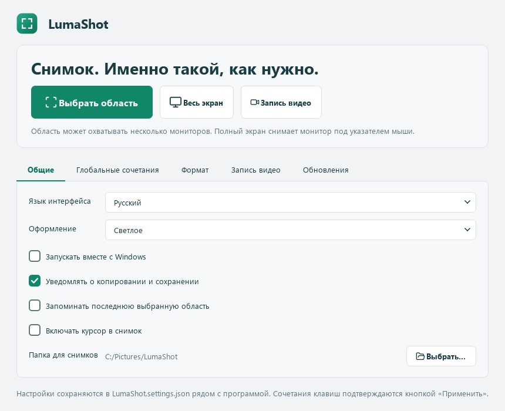
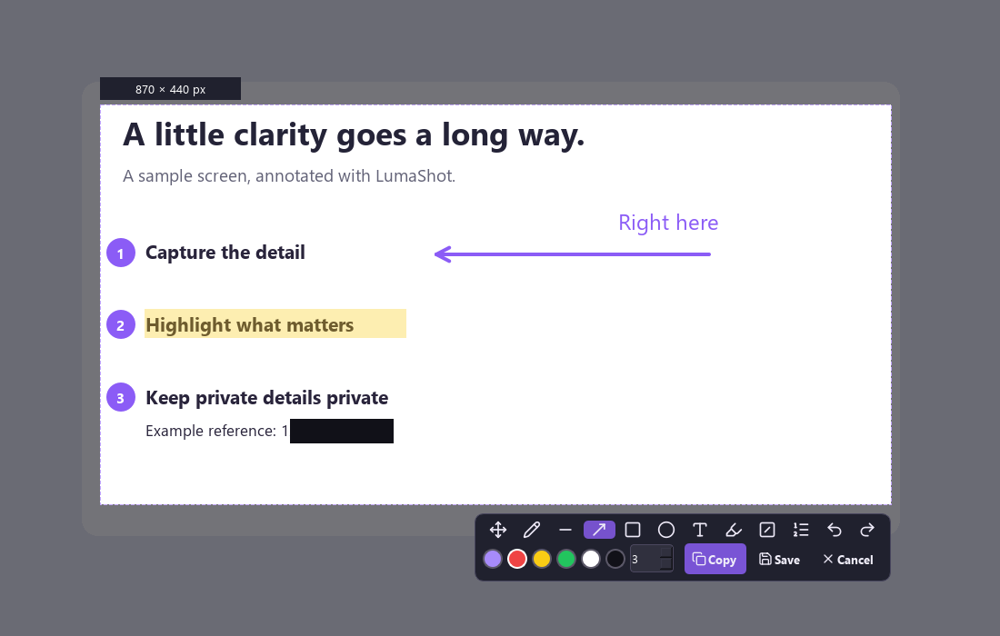
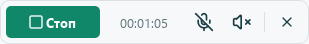
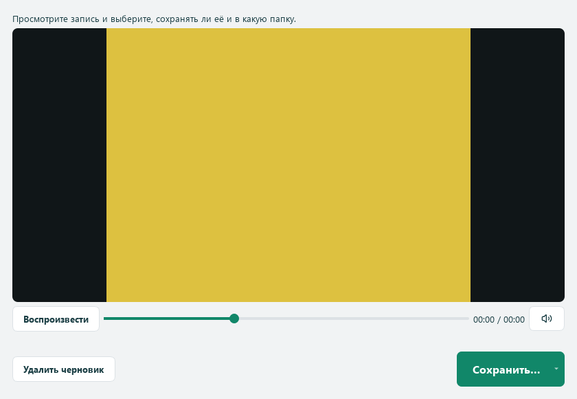
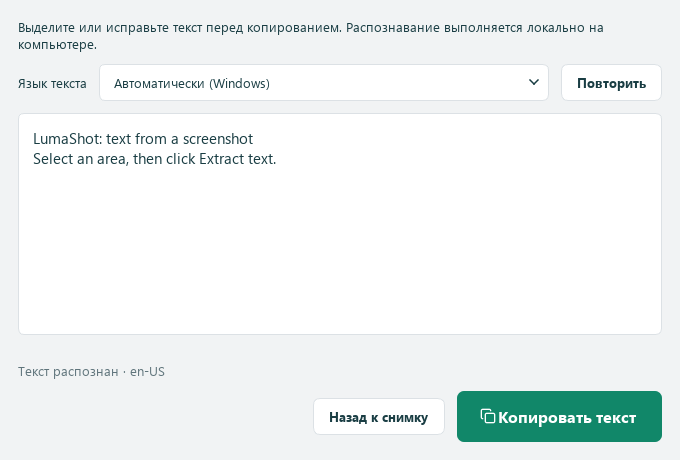
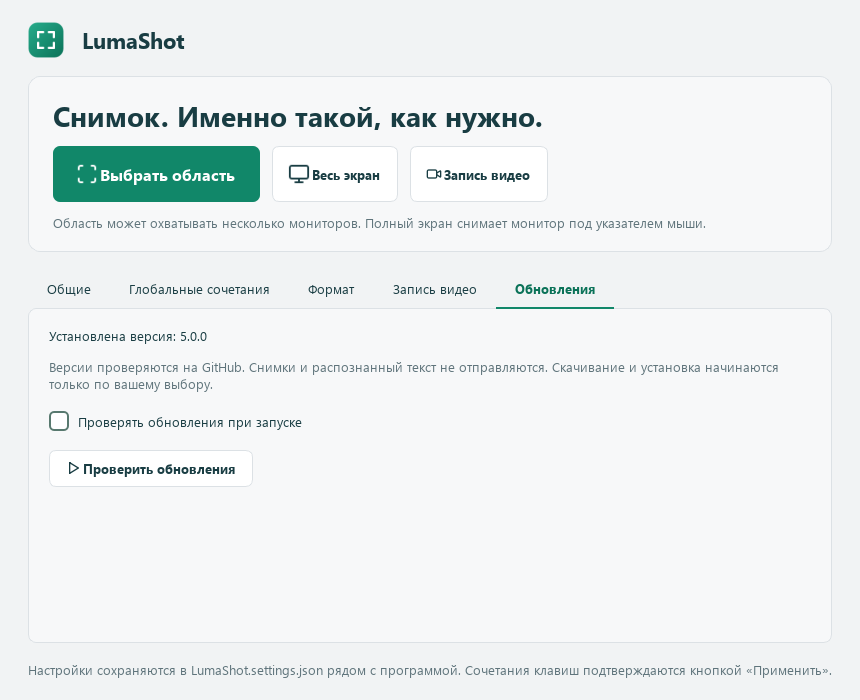
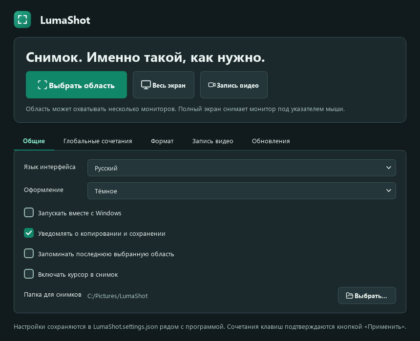

# LumaShot

**Снимок. Именно такой, как нужно.**

[English](../README.md) · [Română](README.ro.md) · **Русский**

Приложение для Windows: снимки нескольких мониторов, пометки и запись выбранной области. Версия **v5 (5.0.0)** включает светлую и тёмную темы с зелёным акцентом, интерфейс RO/RU/EN и переносимые настройки. Снимки остаются локальными: без аккаунта, загрузки в облако и телеметрии.



## Установка в Windows

[**Скачать для Windows**](https://github.com/TOKKAB1/LumaShot/releases/latest)

Скачайте опубликованный установщик из Releases и распакуйте ZIP, если нужно.
Установщик v5 называется **LumaShot-Setup-5.0.0-Windows-x64.exe**.
Python не нужен. Доступны RO/RU/EN, установка для текущего пользователя
и необязательный ярлык на рабочем столе.

## Запуск из Python

Нужны **Windows 10 версии 2004+ или Windows 11** и **64-битный Python 3.10+**.

1. Выберите **Code → Download ZIP** и распакуйте весь архив в папку с правом записи.
2. Откройте терминал в этой папке и выполните:

```powershell
python -m pip install -r requirements.txt
python LumaShot.py
```

PySide6 и SoundCard указаны в [requirements.txt](../requirements.txt); NumPy и CFFI устанавливаются вместе с SoundCard. Интернет нужен при установке библиотек, само приложение работает локально.

Всё приложение находится в одном **LumaShot.py**, включая значки. Можно скачать [только скрипт](https://github.com/TOKKAB1/LumaShot/raw/refs/heads/main/LumaShot.py) и установить `PySide6==6.12.0 SoundCard==0.4.6`. Сохраняйте уведомления о лицензиях внутри скрипта. Для запуска Python файл ICO не нужен.

## Снимки и пометки

Нажмите **Выбрать область**, щёлкните левой кнопкой по значку в трее или используйте горячую клавишу. Область может охватывать несколько мониторов; размер меняется за **8 маркеров**. Редактор открывается в режиме перемещения/изменения размера.

Доступны карандаш, линия, стрелка, прямоугольник, текст, выделение цветом и нумерация. Текущий цвет открывает **палитру из 24 цветов** и настройку толщины. **Ctrl+C** копирует, **Ctrl+S** сохраняет PNG/JPEG. **Enter подтверждает текст и не копирует снимок и не закрывает редактор.**



В режиме перемещения удерживайте **Shift** и щёлкните по пометке для выбора. Перетаскивайте объект или его маркеры с Shift для перемещения и изменения размера. У линий и стрелок редактируются концы. **Shift + двойной щелчок** меняет текст; **Shift+Delete** удаляет выбранный объект. Палитра и толщина применяются к выбранной пометке. **Ctrl+Z / Ctrl+Y** отменяют и повторяют рисование и правки. Маркеры не попадают в сохранённое изображение.

| Клавиша | Действие |
|---|---|
| `Print Screen` / `Ctrl+Shift+F9` | Исходные горячие клавиши области, если доступны |
| `V` | Перемещение / изменение размера |
| `P` / `L` / `A` / `R` | Карандаш / линия / стрелка / прямоугольник |
| `T` / `H` / `N` | Текст / выделение / номер шага |
| `Shift` + перетаскивание | Изменить выбранную пометку в режиме перемещения |
| `Shift` + двойной щелчок | Изменить текст |
| `Shift+Delete` | Удалить выбранную пометку |
| `Ctrl+Z` / `Ctrl+Y` | Отменить / повторить |
| `Ctrl+C` / `Ctrl+S` | Копировать / сохранить снимок |
| `Esc` / правая кнопка | Отменить снимок; Esc сначала отменяет ввод текста |

**Весь экран** снимает монитор под курсором в исходном разрешении. По умолчанию открывается редактор; на вкладке **Формат** можно включить немедленное сохранение. Для нескольких мониторов используйте выделение области. Прямоугольник включает промежутки между экранами.

## Запись, просмотр и сохранение

1. Нажмите **Запись видео** или её горячую клавишу, изначально **Ctrl+Shift+F11**.
2. Выделите область. Сверху появится компактная панель; нажмите **Старт** или горячую клавишу ещё раз.
3. Независимо включайте микрофон и звук компьютера. Изначально оба выключены. **Пауза / Продолжить** сохраняет тот же MP4; время паузы не включается в видео.
4. Нажмите **Стоп** или горячую клавишу для просмотра. Можно воспроизводить, ставить на паузу, перематывать и отключать звук просмотра.
5. Сохраните в папку по умолчанию, выберите другое место или откажитесь от записи. Отмена диалога сохранения оставляет черновик открытым. MP4 копируется без перекодирования.



Тонкая **красная рамка** показывает область записи и становится жёлтой при паузе. Панель и подсказки доступны мышью, но Windows исключает их и рамку из видео. Если исключение недоступно, рамка переносится за пределы области; запись не запускается, если панель нельзя убрать из кадра.



Видео: **MP4 / H.264, целевые 20 кадров/с**, исходное разрешение области. К нечётным размерам добавляется один чёрный пиксель. Запрашиваемый видеобитрейт зависит от площади и ограничен 2–30 Мбит/с; звук — **AAC стерео, 48 кГц, целевые 256 кбит/с**. Фактический результат зависит от кодировщика, содержимого и производительности. Отдельный FFmpeg не нужен.

Используются устройства Windows по умолчанию. После их смены выключите и включите соответствующий источник в панели. Выключение источника и пауза освобождают аудиовход. Закрытие окна просмотра требует решения; выход во время записи тоже ожидает выбора. До сохранения запись находится во временной папке.

## Текст со снимка (OCR)

Выделите область как обычно и нажмите **Извлечь текст** на нижней панели рядом
с копированием и сохранением. Отдельная горячая клавиша OCR не нужна. В новом
окне можно проверить и исправить результат. Выделите часть текста и нажмите
**Копировать текст**, либо оставьте всё без выделения для копирования целиком.
Закрытие окна возвращает к тому же снимку и сохраняет пометки.



Распознаются исходные пиксели области без панелей и добавленных пометок. OCR
Windows запускается локально через Windows PowerShell, без новых Python-зависимостей.
Языки распознавания зависят от пакетов OCR в Windows, отдельно от языка интерфейса.
Выберите доступный язык в окне. Если пакетов нет, приложение объяснит причину и
предложит открыть настройки языков Windows. Мелкий или нечёткий текст может
требовать правки; рукописный текст и сложная разметка не гарантируются.

## Обновления с GitHub

На вкладке **Обновления** нажмите **Проверить обновления**. Проверка при запуске
необязательна и изначально выключена. Используются стабильные версии
TOKKAB1/LumaShot; снимки, распознанный текст и личные настройки не отправляются.



При появлении новой версии прочитайте изменения и выберите **Скачать обновление**.
Файл проверяется по SHA-256, предоставленному GitHub. Поддерживаются EXE установщика
и ZIP с ним. Затем **Установить и закрыть LumaShot** запускает интерактивный
установщик после выхода из программы. Сначала завершите снимок или запись,
сохраните либо удалите черновик. Закрытие окна отменяет скачивание и удаляет
временные файлы.

Обновляется установленное Windows-приложение; исходный Python доступен отдельно.
Для публикации будущих обновлений см. [руководство](UPDATES.md).

## Настройки и трей

| Вкладка | Параметры |
|---|---|
| Общие | Язык, тема, автозапуск, уведомления, запоминание области, курсор, папка |
| Горячие клавиши | Независимые комбинации и включение для области, полного экрана и видео |
| Формат | PNG/JPEG, качество JPEG 1–100, редактор или немедленное сохранение полного экрана |
| Запись видео | Исходные состояния микрофона и звука компьютера |
| Обновления | Ручная и необязательная проверка версий GitHub при запуске |

Настройки сохраняются автоматически; изменения горячих клавиш подтверждаются кнопкой применения. Полноэкранная комбинация изначально выключена; предложено `Ctrl+Shift+F10`. При конфликте сохраняется предыдущая рабочая комбинация.

**Левая кнопка по значку в трее:** выбрать область. **Правая кнопка:** область, весь экран, видео, открыть приложение или выйти. Во время записи пункт видео останавливает её и открывает просмотр, а снимки недоступны. Закрытие главного окна оставляет приложение в трее, если он доступен. Для полного завершения используйте выход. Повторный запуск открывает существующий экземпляр.

**LumaShot.settings.json сохраняется рядом со скриптом или EXE**, поэтому папка должна разрешать запись. Не добавляйте личный JSON в GitHub. Старые настройки Windows переносятся при первом запуске без JSON; повреждённый файл сохраняется для восстановления. Запомненная область восстанавливается для той же конфигурации мониторов.

**Запускать вместе с Windows** — необязательная настройка, изначально выключенная. Приложение запускается в трее при входе. После перемещения программы или окружения Python выключите и включите опцию, чтобы обновить путь.

<details>
<summary>Тёмная тема</summary>



</details>

## Ограничения и проверки

- Только Windows. Разные масштабы мониторов, HDR, реальные аудиоустройства и разрешения требуют проверки на целевом ПК. Большие области зависят от кодировщика и производительности.
- Прокрутка, автоматическое выделение окна и лупа/зум не включены. Защищённое содержимое может не захватываться.
- Просмотр черновика не обеспечивает восстановление записи после сбоя.
- Историей и синхронизацией буфера обмена, если они включены, управляет Windows.

Qt/FFmpeg может выводить сообщения о недоступном AV1 даже при записи H.264 или `track 0: codec frame size is not set`. Сами по себе эти сообщения не означают сбой записи. Реальные ошибки показываются в приложении. EXE запускается без консоли.

## Лицензия

Оригинальный код, документация и значок приложения распространяются по [лицензии MIT](../LICENSE), © 2026 TOKKAB1. Использование, изменение и распространение, в том числе коммерческое, разрешены с сохранением лицензии и уведомления об авторских правах.

Значки Lucide сохраняют ISC/MIT; PySide6/Qt, SoundCard и другие зависимости имеют собственные лицензии. См. [уведомления](../THIRD_PARTY_NOTICES.md). LumaShot — независимый проект, не содержащий код, логотипы или исполняемые файлы Lightshot/Greenshot и не связанный с ними.

[Сообщить о проблеме](https://github.com/TOKKAB1/LumaShot/issues)
